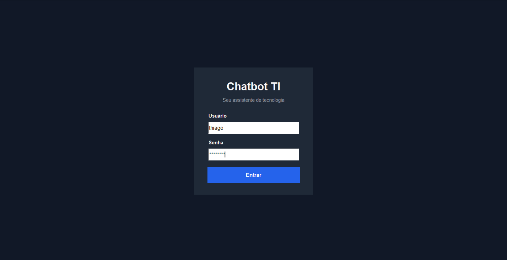
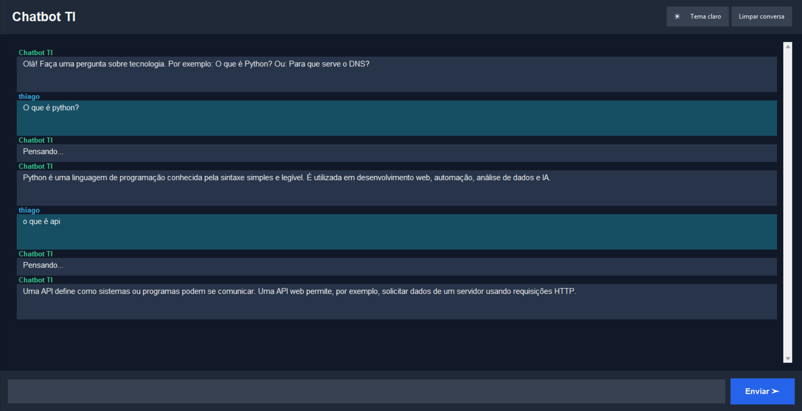

Sobre o projeto:
O Chatbot TI é uma aplicação desenvolvida em Python com Tkinter que responde perguntas sobre Tecnologia da Informação utilizando uma base de conhecimento local.

Funcionalidades:
- Login com usuário e senha.
- Chat com campo para digitar perguntas.
- Respostas sobre programação, redes, bancos de dados e segurança.
- Histórico de mensagens com rolagem.
- Alternância entre tema claro e escuro.
- Botão para limpar a conversa.
- Identificação de perguntas não encontradas na base.

 Tecnologias utilizadas:
- Python
- Tkinter
- Expressões regulares

Acesso:
- Usuário:"thiago"
- Senha: "12345678"

Estrutura dos arquivos:
- main.py: interface, login e funcionamento do chat.
- conhecimento.py: palavras-chave e respostas.
- README.md: documentação.

Como executar
1. Instale o Python.
2. Abra o terminal na pasta do projeto.
3. Execute "python main.py".
4. Entre com as credenciais informadas acima.

Como funciona:
O chatbot normaliza a pergunta, procura palavras-chave correspondentes e retorna uma resposta cadastrada. Caso não encontre, informa que não possui uma resposta específica.

Limitações:
O sistema não utiliza IA generativa. Suas respostas dependem da base de conhecimento e podem ser ampliadas editando o arquivo "conhecimento.py".

Página de login:
.

Página do  chat:
.